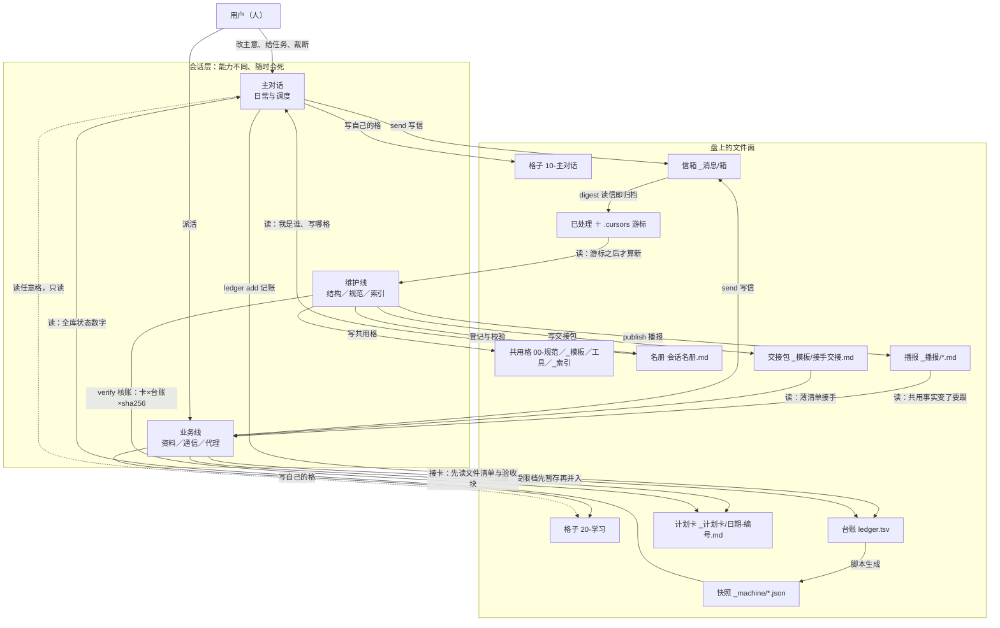
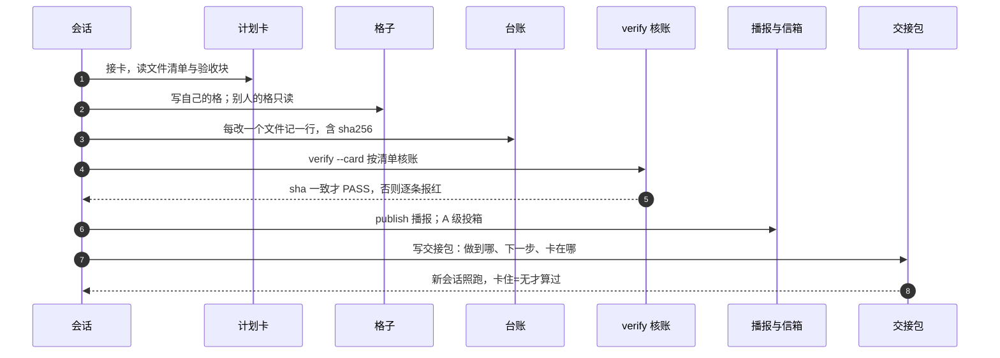

# 工作原理

> 版本：v1.0.4（随发布包 2026-11-08）
> as-of：2026-11-08 10:40（本机实测）

这份讲「它凭什么能跑」：机制、落点、判据、坏法。不讲怎么上手（那是 `使用指南.md`），不讲为什么值得用（那是 `../README.md`）。

约定：路径都相对协作库根；`_计划卡\`／`_播报\`／`_消息\`／`_模板\` 这类简写相对 `40-协作\`；`<工作区>` 指协作库所在的工作区，`<DSH_HOME>` 指宿主的用户目录；文档内路径统一用**正斜杠**（`docs/工作原理.md`），只有命令行示例里为 Windows 读者保留反斜杠。

---

## 0. 取数口径

| 项 | 值 | 怎么取的 |
|---|---|---|
| 库龄 | 2026-10-22 起，十七天 | 最早播报 `20261022`、最早台账 `2026-10-23 16:14:04` |
| 会话／信箱箱／未读 | 44／8／75 | `read_state.py --doctor` |
| 台账 | 1881 行 | `wc -l 40-协作\_计划卡\ledger.tsv` |
| 计划卡 | 136 张 | `ls 40-协作\_计划卡\*.md` |
| 播报 | 277 篇 | `ls 40-协作\_播报\*.md` |
| 信件 | 541 封 | `find 40-协作\_消息 -name "*.md"` |
| 文档 | 1131 个 md | `find 协作库 -name "*.md"` |
| 自检 | 14 项 | `kb_check.py` |
| 宿主 | DSH `0.2.2-rc.1`；profile 15 bundle／13 依赖 | 应用 `package.json`、profile `package.json` |

时长、体积、条数这类事实一律从证物算：台账最早一行、播报最早一个文件、`ls | wc` 的结果。不写「跑了很久」「一百多张」这种印象量——同一个库两个人看，差别就在有没有时刻。表里是 10:40 截面；库是活的，你复跑时条数可能多出几条，那是 10:40 之后别的线写进去的，不是口径变了。

## 1. 一句话：机制是什么

**协作的真相从上下文里搬到了盘上：事件只负责叫醒，文件负责说话。**

七个文件面（格子／信箱／名册／台账／计划卡／交接包／播报）各自只有一个写者；每次改动落一行可核的账（字节数＋sha256）；会话之间的通知走一条允许坏的通路。于是宿主重启、插件内存清零、某条会话死掉，最坏结果是「没人叫你自己去翻」，而不是「事实丢了」。

三条推论，后面每一节都在解释其中之一：

| 推论 | 落点 |
|---|---|
| 写权按目录切分，不按人情 | 格子 ＋ 名册 |
| 状态先落盘，再发通知 | 台账 ＋ 信箱 ＋ 播报 |
| 「完成」＝ 别人能独立复核 | 计划卡 ＋ 台账 ＋ sha256 |

## 2. 全貌



三条通路，坏了后果完全不同：

| 通路 | 谁写 | 谁读 | 坏了会怎样 |
|---|---|---|---|
| 文件通路（格子／台账／计划卡／播报／交接包） | 各格主人、维护线 | 所有会话、脚本 | 真坏。事实丢失，只能靠人回忆 |
| 消息通路（信箱） | 发件人 | 收件箱的主人 | 降级：改成手动翻箱，信还在盘上 |
| 事件通路（投递唤醒、定时） | 宿主插件 | 目标会话 | 降级：改成轮询或人叫。盘上一切不动 |

一句话记住：**事件坏了是慢，文件坏了是丢。**

## 3. 七个文件面

每面按「是什么／谁写／谁读／坏了会怎样」四件事说。

### 3.1 格子（目录归属）

一个目录一个主人。`00-规范\`、`_模板\`、`_计划卡\`、`_播报\`、`工具\`、`_索引.md` 是共用格，由维护线单点写；`10-主对话\`、`20-学习\`、`30-邮件\` 各归各线。判据不是「权限够不够」，而是「这块事实归谁」——权限全开也不越界，靠分工不靠 ACL。

| 谁写 | 谁读 | 坏了会怎样 |
|---|---|---|
| 格子主人；共用格＝维护线 | 任何人可读，读别人的格不改 | 两人同改一文件，后写的覆盖前写的，且不报错；只在台账留下同一路径两行 |

机器能查到的只有事后线索：自检第 9 项（名册与盘上一致）、`line_perm`（9 条线／词表 4 项）、双线告警（同一天两处改了同一文件 ⇒ 提示「是不是两个人」）。它们是线索不是结论——同一人换署名写法也会命中。

### 3.2 信箱（`_消息\`）

会话之间不靠用户传话，靠异步信。时间戳就是水位线：

```
_消息\<箱>\<YYYYmmdd-HHMMSS>-from-<发件人>.md      # 未读
_消息\已处理\<箱>\<同名>                            # 已读归档
_消息\.cursors\<箱>                                 # 公共游标，谁读谁推
_消息\.cursors\<箱>@<读者名>                        # 私有游标，一名读者一个
_消息\兜底待收\from-fallback-*.md                   # 受限档位发信的落点
```

| 谁写 | 谁读 | 坏了会怎样 |
|---|---|---|
| 发件人写进收件人的箱 | 读者读自己的箱＝收信（归档＋推游标）；读别人的箱必须 `--peek` | ① 两线共用一个箱：谁先读谁把游标推到末封，另一线永久丢信且不报错；② 归档失败仍推游标：那封信永久消失；③ 游标静默回落到临时目录：老信回潮 |

三条硬约定，每条都对应一次真实事故：

- **文件名就是时间线**：排序、去重、老化全看文件名里的时间戳，不看 mtime（复制、同步、`touch` 都会改 mtime）。
- **fail-closed 归档**：搬到 `已处理\` 成功才推游标，失败就停在这一封，末尾打「滞留 N 封」。宁重读不丢信。
- **共用箱必须私有游标**：`digest --for other --as linalg`。一个读者顺手跑不带 `--as` 的 digest，另一个读者第二天什么都读不到。（`--as` 与下面的 `repair` 都是完整库的脚本；随包最小实现只有 `send`／`status`／`digest`／`--peek`，所以 L1 的规矩是「一箱一线」，别让两个人共用一个箱。）

恢复动作：`repair --for <箱>` 只报告，`--apply` 才搬（只搬不删），**搬完必须再跑一次 `digest`**——repair 不读信、不推游标，漏这步就是「箱子看起来空了、其实一封没读」。这条属于完整库；最小实现里对应的手工动作是：把信从 `<箱>` 移到 `已处理/<箱>`，再写对游标。

### 3.3 名册（完整库在 `10-主对话/会话名册.md`；最小库放库根 `名册.md`）

「我是谁」的唯一权威，分两段：

| 段 | 内容 | 谁写 |
|---|---|---|
| AUTO 段 | 会话 id、工作区、状态、有无目录、桥引用、最后活动、体积 | `session_registry.py` 生成，不许手改 |
| 手工段 | 角色、负责的格子、权限档、起用时间 | 人写；脚本只校验「引用的 id 在 AUTO 段里存在」 |

读：每个会话开工跑 `read_state.py --me <会话 id 或前 8 位>` 认自己，维护线据此判「这块该谁写」；名册里的 id 只写前 8 位加省略号（形如 `session-1a2b3c4d…`），脚本按前缀匹配。坏了：手工段引用了已消失的 id ⇒ 自检第 9 项红；名册与盘上不一致 ⇒ `--doctor` 报 `[DRIFT]` 并退出 1；手改 AUTO 段 ⇒ 下次生成被覆盖。

### 3.4 台账（`_计划卡\ledger.tsv`）

一行一个文件，七列：`ts`／`action`／`path`／`size`／`sha256`／`note`／`by`。这是整套东西里唯一「不许漂亮、只许准」的文件。`by` 是后加的第 7 列，早期行只有前六列——读的时候按列数容错，不要因为老行少一列就判它坏。

| 谁写 | 谁读 | 坏了会怎样 |
|---|---|---|
| `ledger.py add`，由改文件的人记；代别人记时 `by` 写清是谁 | `verify.py` 核账、`kb_check.py`、双线告警、后来接手的人 | 漏记 ⇒ 盘上有、账上没有，验收红；记了之后文件又被改 ⇒ sha 对不上，当场红；`note` 必填且不接受「已办」这类空话，要写为什么 |

本机的台账第一行是 `2026-10-23 16:14:04 create 40-协作\_计划卡\模板.md`，末行是 `2026-11-08 00:00:38` 的一条 `create`（别的线并暂存）。`ledger.py list` 会打印「共 N 条」。

### 3.5 计划卡（`_计划卡\日期-编号.md`）

每批活一张卡，最少六段；其中 `涉及文件` 与 `验收` 两段是给机器读的：

| 段 | 作用 | 谁读 |
|---|---|---|
| 目标 | 做完之后什么状态叫完成 | 人 |
| 步骤 | 逐条：改哪个文件、改成什么 | 人 |
| 涉及文件 | 机器读：验收按这份清单核「在不在、台账有没有、sha 对不对」 | `verify.py` |
| 验收 | 机器读：命令逐条跑，全 PASS 才算完成 | `verify.py` |
| 完工记录 | 收尾时写：跑了什么、结果如何、偏差在哪 | 接手的人 |
| 本卡不做／风险与回滚 | 挡住顺手带进去的改动；出事照回滚退 | 人 |

谁写：接活的那条线，动手之前写。坏了：没有文件清单 ⇒ 验收无从核；卡里说改 A、实际改了 A+B+C ⇒ 台账对不上、播报漏；验收块为空 ⇒ 卡永远 PASS，等于没验收。

卡外改动不是绝对禁止，但要「先问后动」；真做了就写进「偏差记录（如实记，不藏）」，并在播报里点明。

### 3.6 交接包（`_模板\接手交接.md`）

给新会话的一份薄清单，八步：判档位 → 交接三动作 → 体检 → 收信 → 认自己 → 读文档 → 判要不要写卡 → 完工收尾。每步给可直接粘的命令，并写「看到什么算正常」。

| 谁写 | 谁读 | 坏了会怎样 |
|---|---|---|
| 要下线的那条线，交班前写 | 新会话，开场照跑；人也会读 | 写成长文没人读完；没被真会话跑过就发版 ⇒ 新会话卡在第二条。验收标准只有一条：**卡住＝无** |

「卡住＝无」的意思是：真开一个新会话，只给它这份文档，问它卡在哪；答「没卡」才算这份文档合格。我们改过两轮才做到。

### 3.7 播报（`_播报\*.md`）

跨格事实变更的通报。固定四段：变了什么／影响谁／要做什么／证据在哪。A 级投相关箱，B 级只落目录不投箱；次日并成日报，单条只留指针。

| 谁写 | 谁读 | 坏了会怎样 |
|---|---|---|
| `mailbox.py publish`，发件人自己的箱会被跳过 | 所有线；`kb_check` 第 8 项也读它 | 只写标题不写动作 ⇒ 别人不跟；攒着最后一起发 ⇒ 自检第 8 项红（比对共用格最后修改时间与最新播报时间）；事后改正文不改标题 ⇒ 索引行与交叉引用对不上 |

## 4. 一次协作的生命周期



每步的落点与判据：

| 步骤 | 落在哪个文件面 | 判据 | 红了说明什么 |
|---|---|---|---|
| 接卡 | 计划卡 | 卡里有文件清单和验收块 | 卡没写完就动手了 |
| 读格子 | 格子（只读） | 只改自己那格 | 改到别人的格，台账会露出两处 |
| 改文件 | 格子 | 改动范围＝卡里清单 | 卡外改动（哪怕两行） |
| 记账 | 台账 | 每个文件一行，`note` 写为什么 | 漏记或记了又改 |
| 验收 | 计划卡＋台账 | sha256 一致、命令块全过 | 账实不符，或有命令没过 |
| 播报 | 播报 | 共用格改过必须有当轮播报 | 自检第 8 项红 |
| 交接 | 交接包 | 新会话照跑「卡住＝无」 | 文档只对人友好，对要动手的人不友好 |

顺序不是仪式：`verify` 必须在记账之后（它核账），索引重建必须在改完之后，播报必须在体检之前（第 8 项查它），快照同步必须在播报之后（快照得包含新播报），`--doctor` 最后兜。

## 5. 三条铁律与它们的判据

| 铁律 | 一句话 | 判据 | 机器怎么查 |
|---|---|---|---|
| 单一写者 | 一份事实只有一个写者 | 每个目录在名册里有且只有一个主人；共用格只有维护线写 | 自检第 9 项（名册与盘上一致）、`line_perm`（9 条线／词表 4 项）、双线告警（同一天同一文件两处改） |
| 先记账后动手 | 状态先落盘，再发通知 | 台账里每个改动文件一行，且行早于播报 | `verify.py` 比对「卡里声明的文件」与台账行；漏一个就红 |
| 账实相符＝sha256 | 完成＝字节数与哈希都对得上 | 台账的 `sha256` 与文件现状逐字相同 | `verify.py --card` 重算每个文件的 sha256 |

**5.1 单一写者。** 判据不是「谁有权限」，是「这块事实归谁」。多会话并行只有一条线能写库；别的线要改共用格，发信请求，不自己动手。代价是维护线成为瓶颈，换来的是「不用问也知道现在归谁」。

**5.2 先记账后动手。** 投递也一样：信封先落 `pending`，送达改 `delivered`，失败可重投。反例是真实事故——补投逻辑把「已投到」判成「待重投」，账本自增殖，二十分钟里唤醒了二十次。判据是哨兵消息 id 划界：只看哨兵之后的行，出现「投递中→已送达」成对记录，才说明新代码在跑。

**5.3 账实相符＝sha256。** 这是唯一一条能挡住「改完就忘」的判据。拿一张 11-05 的旧卡在 11-08 复跑，机器当场点出两处：

```text
[FAIL] 台账一致：40-协作\_交接-2026-11-05-第四任-交出（DSH升级前）.md
       - sha256 不一致（台账 0127ac21f5a4… 现 1329587019cb…）
[FAIL] 台账一致：40-协作\_模板\接手交接.md
       - sha256 不一致（台账 e54a8eae8ccf… 现 38fb1c95cba0…）
[PASS] 台账一致：40-协作\_计划卡\2026-11-05-M137-第四任交出（交接包与as-of）.md
结果：3 项 FAIL
```

前两条是「文件后来被改过、台账没跟上」；第三条红来自命令块里的体检——它自己也有红项。验收会把体检一起拉进来，这是设计：卡说完成，就得连库的体检一起过。人写的计划会漏，sha 不会。

## 6. 坏了会怎样

| 坏在哪 | 表面症状 | 撑着走的是什么 | 恢复动作 |
|---|---|---|---|
| 事件通路（投递／唤醒） | 信到了但没人被叫醒；或同一件事被叫多次 | 盘上的信还在，游标未动 | 收件人手动 `digest`；查投递账本的 `pending` 残留；重投前先看哨兵 |
| 压缩停摆 | 上下文单调涨、块数不增 | 交接包＋台账（进度都在盘上） | 开到新会话，照交接包接手；老会话把未落盘的事先写进卡 |
| 信箱游标被误推 | 「无新消息」但箱里有信 | 已处理目录里的同名文件仍在 | 用 `--peek` 逐封确认；必要时手工把游标写回上一封 |
| 归档失败被吞 | 同一封信每轮都被当新信 | —— | 补上 fail-closed：搬不动就停；查文件句柄占用与权限 |
| 台账漏记 | 验收红「盘上有、账上没有」 | 计划卡的文件清单 | 补账：用 `ledger.py add` 记实测值，不伪造哈希 |
| 索引落后 | 检索到旧标题；自检第 12 项红 | 文档本身还在 | 跑 `kb_index.py` 重生成（生成物，不许手改） |
| 快照落后 | 别的会话按旧数字行动；`--doctor` 报 `[DRIFT]` | 盘上真实数据 | 跑一条会同步快照的命令；`--doctor` 复核到 PASS |
| 名册过期 | 认错身份、写错格 | 盘上目录归属 | 重跑注册脚本生成 AUTO 段；手工段改「已交班 → 新 id」 |
| 播报没发 | 自检第 8 项红；别人按旧理解做事 | 台账与卡里的记录 | 当轮补发，四段写全；次日并进日报 |
| 双线同改一文件 | 一边看到绿、一边看到红 | 台账的 sha 与双线告警 | 以台账 sha 为准判断谁的最后一次为准；把另一处改动重做 |
| 受限档位写不进盘 | shell 报 `PermissionError`；信落兜底目录 | write 工具通常还能写；兜底待收 | 全权会话跑 `sweep` 收兜底信；账暂存后由有权限的人并入 |
| 宿主升级／路径变了 | 工具面报「库根不对」并 `rc=2` | 文件协议完全不受影响 | 指回环境变量；脚本拒绝猜测路径，宁可退出也不静默降级 |
| 交接包过期 | 新会话卡在第二步 | 台账＋计划卡（事实仍在） | 重写接手清单，真开一个新会话演练 |

判读原则：先分「我做错了」和「判据写错了」两种。判据错了就改判据，并把改法落成能复跑的命令——下次同类争议复跑一次就能自证。

## 7. 与宿主的边界

这套东西跑在一个会升级、会改名、会坏的宿主上（参考实现 DSH `0.2.2-rc.1`；能力清单在 `<DSH_HOME>\profiles\desktop\package.json`，15 个 bundle／13 个依赖）。它自己划了一条线：**上层只认插座，不认插在上面的东西。**

### 7.1 属于文件协议的部分（换 harness 不用改）

| 事物 | 约定 | 为什么能跨 harness |
|---|---|---|
| 目录归属 | 一个目录一个主人；共用格单点写 | 目录与读写权是文件系统概念 |
| 信箱 | 时间戳文件名＋`已处理`＋游标文件 | 只用 rename／读目录／写文本 |
| 台账 | TSV，七列，含 sha256 | 哈希是通用算法，谁都能重算 |
| 计划卡 | markdown，文件清单＋验收命令块 | 命令是 shell 命令，不绑宿主 API |
| 播报 | markdown，四段固定 | 就是文件 |
| 交接包 | markdown，有序清单＋可粘命令 | 同上 |
| 快照 | 纯 ASCII JSON＋`schema.json` | 任何语言都能读；schema 先于生成物 |

### 7.2 属于宿主能力的部分（要换等价物）

| 能力 | 参考实现 | 等价物 | 没了会怎样 |
|---|---|---|---|
| 工具面 | `dsh-kbhub`（stdio MCP，工具名 `kbhub_*`）：读库、列收件箱、跑自检、写探针 | 同一份 MCP 服务接到别家；或 shell 调脚本 | 受限档位下 shell 写不进盘时，就没有第二条写盘通道 |
| 投递与唤醒 | `dsh-session-mesh`：把信投进对方箱并叫醒 | hook、cron／计划任务轮询 | 降级成轮询或人叫，正确性不变 |
| 侧栏自愈 | `dsh-session-auto-refresh`：侧栏缺会话时重载一次 | 多数 harness 没有；手动刷新 | 只影响「以为这条线没了」的错觉，不影响正确性 |
| 上下文管理 | `billion-context`／`dsh-context`：自动折叠 | 任何上下文压缩机制，或换新会话 | 长会话要么贵、要么爆；交接包就是为此存在 |
| 定时与作息 | `dsh-proactive`：闹钟／作息表 | 系统计划任务 | 被动档变纯手动 |
| 权限档位 | 宿主授予的 workspace-write／danger-full-access | 容器、只读挂载、审批弹窗 | 判据不变（两条写盘测试定档），但要重写「哪些命令能跑」 |

> **命名口径**：三件自研插件对外一律用 `dsh-` 前缀（`dsh-kbhub`／`dsh-session-mesh`／`dsh-session-auto-refresh`），发布包里的 tgz 就是这个包名。改名时只动三处——包的 `name`、插件补丁里 `insert[].name`、宿主的依赖与 bundle 列表；补丁里的 `id`（配置槽 id）**始终不动**，否则用户挂在上面的开关会丢。本地开发环境把依赖指向源码目录，包名可与发布形态一致而形态是链接，属于部署差异，不是命名差异。

**换 harness 唯一会损失的是「自动叫醒」**：信箱照收、台账照记、交接照接。这也是为什么 L3 那层被单独隔出来，可选。

## 8. 最小验证

这一节全部用发布包里的文件，不需要另外装东西。在包根依次跑（都只读，不改盘）：

```bash
python starter/mailbox_min.py --selftest            # 期望末行：selftest=PASS（依次未读：2/2/3/0，a 箱信数 0）
python starter/mailbox_min.py status                # 期望：打印有信的那些箱的未读/共几封
python starter/mailbox_min.py digest --for a --peek # 期望：列信但不推进游标
```

再确认这些文件都在（任一缺失＝下载不完整）：`README.md`、`docs/工作原理.md`、`docs/使用指南.md`、`starter/mailbox_min.py`、`starter/card-template.md`、`starter/boot-template.md`、`starter/closeout.sh`、`skills/` 下七份 `SKILL.md`、`plugins/` 下三件 tgz。

### 8.1 库自己的自检（只在完整库里跑）

完整库（不是这个发布包）另有一套自检脚本，位于库的 `工具/` 目录，不在包里：

```bash
python ..\工具\kb\kb_check.py            # 14 项逐项 PASS/FAIL，末行合计
python ..\工具\kb\read_state.py --doctor # 机器层对账：会话/信箱箱/未读
python ..\工具\kb\ref_check.py --baseline # 死链：已知 31 条 / 新增 0
python ..\工具\kb\docid.py check         # 文档 id 登记是否一致
```

`kb_check.py` 的 14 项是：目录骨架、编号唯一、死链、目录 README、修订记录格式、脚本存在、旧字样、共用格已播报、名册一致、启动语模板、邮件桥健康、索引不落后、机器层 JSON、文档 id 登记。

维护者注：第 12 项（索引落后）与第 14 项（文档 id 未登记）是**最容易被误读成「库坏了」的红项**。它们红的唯一原因通常是：有新文件刚写进库，索引还没重建、id 还没登记——即「新文件先入库、后重建索引、后登记」。按提示跑一次重建与登记就绿；重建登记之后仍旧红，才是真问题。

## 9. 它不保证什么

| 不保证 | 说明 | 现在的替代 |
|---|---|---|
| 文件锁 | 只有事后告警，并发写同一文件仍可能覆盖 | 单一写者＋sha 核对＋双线告警 |
| 多机同步 | 没有；同一台机器、同一块盘 | 备份靠整包清单与整包哈希自证 |
| 自动叫醒的分发 | 参考实现是照抄本机配置，不是装得上的包 | 换 harness 时用 hook／cron 自己搭 |
| 免配置 | 装机步骤可复现，但不是一键 | 使用指南给了逐条命令 |
| 判断「该不该做」 | 只保证做了的事说得清 | 计划卡的目标段＋卡外改动先问 |
| 长会话的固定成本 | 交接包越厚，接手越贵 | 「按需加载」还只是候选项 |

---

**一句话收尾**：它把「协作的真相」放在盘上——事件负责叫醒，文件负责说话；坏了就降级成轮询，账本永远在。
